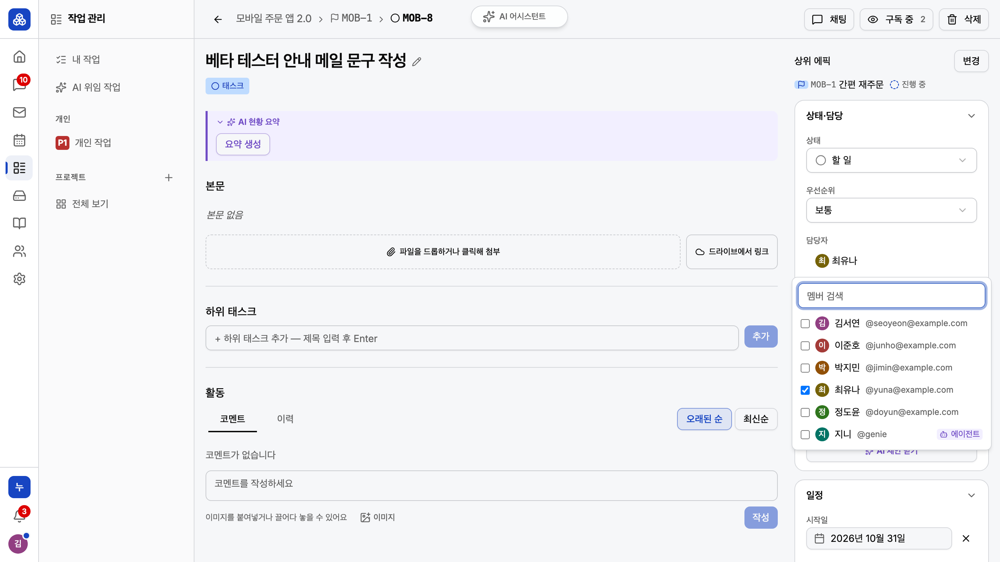

# 제품 매뉴얼

Gen:iA Works 의 매뉴얼 두 권을 Markdown 원본에서 HTML 을 거쳐 A4 세로 PDF 로 만든다. 화면 그림에는 빌드 때 번호 표식을 얹고, 표식 번호는 본문 절차 번호와 맞물린다.

| 권 | 대상 | 원본 | 산출물 |
| --- | --- | --- | --- |
| 사용자 매뉴얼 | 구성원·테넌트 관리자 (`workplace-web`) | `user/NN-<slug>.md` | `dist/manual/user/genia-works-user-manual.pdf` |
| 운영자 매뉴얼 | 슈퍼어드민 (`workplace-admin`) | `operator/NN-<slug>.md` | `dist/manual/operator/genia-works-operator-manual.pdf` |

매뉴얼은 제품 설명의 기준 문서다. 화면에 없는 기능·문구·AI 결과를 쓰지 않는다. 장을 쓰거나 고치기 전에 집필 규칙 스킬 [`.claude/skills/manual-authoring/SKILL.md`](../../.claude/skills/manual-authoring/SKILL.md) 을 읽는다.

## 명령

저장소 루트에서 실행한다. `<book>` 은 `user` 또는 `operator` 다(생략하면 검사는 두 권 모두, 빌드는 `user`).

| 명령 | 하는 일 |
| --- | --- |
| `pnpm manual:check [<book>]` | 프론트매터(`part` 포함), 장 `routes` 와 앱 라우터 대조(미커버·유령·중복), 이모지, 그림·표식 키 존재. 오류가 있으면 실패 |
| `pnpm manual:prose [<book>]` | 굵게 쓴 문구를 앱 소스의 한국어 화면 문구와 대조(못 찾은 것은 「미확인 굵게」 목록으로만 출력), 알림 상자 표기, 장 번호 앞 0, 강조 미종결, 남은 `TODO(집필)` |
| `pnpm manual:pdf [<book>]` | `dist/manual/<book>/manual.html` 과 PDF 를 만든다(Playwright Chromium 인쇄). 장이 없거나, 못 실은 그림이나 없는 표식 키가 있으면 실패(예전 산출물은 먼저 지운다) |
| `pnpm manual:shots` | 화면을 찍고 표식 좌표를 `shots/<book>/boxes.json` 에 기록한다. 환경변수 `MANUAL_BOOK`(기본 `user`)·`MANUAL_WEB`·`MANUAL_API`·`MANUAL_PASS` — 뒤의 셋은 기본값이 없어 찍을 장면이 있으면 반드시 준다. 일부만 다시 찍기는 `MANUAL_SHOTS_ONLY=id,...`. 실패한 장면의 좌표는 기록하지 않는다 |
| `pnpm test:manual` | 매뉴얼 도구의 단위 시험 |
| `node docs/manual/scripts/seed-operator.mjs` | 운영자 매뉴얼 촬영용 가상 테넌트를 격리 스택에 넣는다. 환경변수 `MANUAL_API`·`MANUAL_PASS`(둘 다 필수, 값은 출력하지 않음). 빈 DB 의 첫 가입자를 슈퍼어드민(`ops@example.com`)으로 만들고, 나머지는 플랫폼 API 로만 넣는다. 다시 돌려도 된다(있는 테넌트·계정은 건너뜀). **운영자 매뉴얼 격리 스택에만 돈다** — `MANUAL_API` 가 `http://localhost:6166` 이 아니면 멈춘다(공유 개발 DB·다른 세션 스택의 첫 가입 자리를 가져가지 않게) |
| `node docs/manual/scripts/seed-user.mjs` | 사용자 매뉴얼 촬영 테넌트(누리커머스)를 가상 회사 데이터로 채운다. 이미 만든 테넌트에 소유자로 로그인해 HTTP API 로만 넣는다. 환경변수 `MANUAL_API`·`MANUAL_TENANT_SLUG`·`MANUAL_PASS`(셋 다 필수, 비밀번호는 출력하지 않음), localhost 가 아니면 `MANUAL_SEED_CONFIRM`(slug 와 같은 값)도 필수. 빈 테넌트에만 돈다 — 아래 「사용자 매뉴얼 촬영 테넌트」 |

종료 코드는 네 명령 모두 0 성공, 1 검사·빌드·촬영 실패, 2 사용법 오류(알 수 없는 책 등)다. `seed-user.mjs` 는 0 성공, 1 가드에 걸려 멈춤(쓴 것 없음)·도중 실패, 2 사용법 오류(환경변수 누락, 확인값 없음 등)다.

## 폴더 구조

```
docs/manual/
  README.md                 이 문서
  user/NN-<slug>.md         사용자 매뉴얼 원본
  operator/NN-<slug>.md     운영자 매뉴얼 원본
  shots/targets.md          촬영 대상 표(그림 id·경로·계정·준비 조작·자르기·표식 키·시드)
  shots/<book>/<id>.png     촬영 원본(커밋)
  shots/<book>/boxes.json   자르기·표식 상자 좌표(원본 px, 커밋)
  styles/manual.css         PDF 스타일(A4 세로)
  scripts/
    build.mjs               HTML → PDF 빌드
    check.mjs               구조 검사
    prose.mjs               산문 검사
    capture.mjs             촬영
    scenes/<book>.mjs       촬영 장면(촬영 대상 표를 구현, 공용 도구는 lib/scene-kit.mjs)
    seed-operator.mjs       운영자 매뉴얼 촬영용 시드(격리 스택, 플랫폼 API)
    seed-user.mjs           사용자 매뉴얼 촬영 테넌트 시드(이미 만든 테넌트, 소유자 토큰으로 HTTP API)
    import-intro-shots.mjs  소개서 촬영본을 04장 샘플 그림으로 가져오기(샘플 전용, WP-1196 에서 삭제)
    lib/                    공용 모듈(책 설정·명령줄, 장 읽기, 프론트매터, 마크다운 줄·펜스·링크, HTML, 그림, boxes.json, 렌더, 라우터, 화면 문구, 촬영 도구)
dist/manual/<book>/         빌드 산출물(커밋하지 않음)
```

## 그림

그림은 원본을 그대로 두고 빌드 때 잘라 표식을 얹는다.

```markdown
{crop=picker marks=picker,agent}
```

`crop` 은 `boxes.json` 상자들의 합집합으로 자르고, `marks` 는 적은 순서대로 1부터 번호를 얹는다. 번호 원은 상자 바깥의 빈 자리를 빌더가 고르고, 자리가 없으면 검사가 실패한다(`key@r` 로 자리 지정, `key!inside` 로 상자 안 — 집필 규칙 스킬). 화면이 바뀌면 그 그림만 다시 찍으면 된다. 자르기 폭 기준과 촬영 환경은 집필 규칙 스킬에 있다.

## 현재 상태

- 사용자 매뉴얼은 01 소개 · 02 로그인과 화면 구조 · 03 홈 · 04 AI 와 함께 일하기가 있다. 그래서 `manual:check user` 는 나머지 장의 경로를 `[미커버]` 로 보고한다.
- 01~03·05·07장 그림은 운영의 매뉴얼 전용 테넌트(누리커머스)에서 `scenes/user.mjs` 로 찍었다(읽기만 하는 장면, 쓰기 요청은 브라우저 안에서 차단(`guardReadOnly`), 브라우저 시계 고정 — 촬영 대상 표 「사용자 매뉴얼」).
- 04장 그림은 아직 소개서 촬영본(가상 회사 누리커머스)을 빌려 쓴 샘플이다. 매뉴얼 테넌트에서 다시 찍는다.
- 운영자 매뉴얼은 4개 장(소개와 로그인, 테넌트 만들기와 고치기, 테넌트 구성원, 테넌트 정지·활성화와 삭제)이 모두 있다. 그림은 격리 로컬 스택에서 찍었다.

## 운영자 매뉴얼 다시 찍기

운영 슈퍼어드민 화면에는 실제 고객사 이름이 보이므로 **격리 로컬 스택**에서만 찍는다. 포트는 **DB 5446 · API 6166 · 운영자 콘솔 6275** 로 고정한다 — 개발용(5434·6060·6173·6174)과 다른 세션의 격리 스택(5444·6160)을 건드리지 않는다. 시드는 API 가 localhost:6166 일 때만 돈다(`lib/operator-seed.mjs` 의 `OPERATOR_STACK_API_PORT`).

1. 빈 DB 를 띄운다: `docker run -d --name manual-op-db -e POSTGRES_DB=workplace -e POSTGRES_USER=app -e POSTGRES_PASSWORD=app -p 5446:5432 pgvector/pgvector:pg18`
2. API 를 6166 에 띄운다(`apps/workplace-api` 에서 `./gradlew bootJar -x test` 로 만든 jar): `java -jar <jar> --spring.profiles.active=local --server.port=6166 --spring.datasource.url=jdbc:postgresql://localhost:5446/workplace --spring.flyway.url=jdbc:postgresql://localhost:5446/workplace --app.cors.allowed-origins=http://localhost:6275 --workplace.tenant-purge.delay-ms=3600000 --workplace.tenant-purge.initial-delay-ms=3600000` — 영구 삭제 잡의 첫 실행과 주기를 모두 한 시간으로 미뤄야 「영구 삭제 중」 화면이 촬영 동안 남는다(첫 실행 지연을 주지 않으면 잡이 기동 직후 한 번 돈다). 촬영은 API 를 띄운 뒤 한 시간 안에 끝낸다.
3. 운영자 콘솔을 6275 에 띄운다: `apps/workplace-admin` 에서 `DEV_API_PORT=6166 pnpm exec vite --port 6275 --strictPort` (`DEV_API_PORT` 가 개발 프록시 대상 포트다. 없으면 6060 — 사용자 웹과 같은 이름).
4. 시드: `MANUAL_API=http://localhost:6166 MANUAL_PASS=<가상 비밀번호> node docs/manual/scripts/seed-operator.mjs`
5. 촬영: `MANUAL_BOOK=operator MANUAL_WEB=http://localhost:6275 MANUAL_API=http://localhost:6166 MANUAL_PASS=<같은 비밀번호> pnpm manual:shots`

일부만 다시 찍을 때는 `MANUAL_SHOTS_ONLY` 에 그림 id 를 적는다. 한 장면이 여러 그림을 찍으면(영구 삭제 확인 창 → 진행 배너 → 삭제됨 목록: tenant-lifecycle-7·8·6) 그중 하나만 적어도 그 장면 전체가 돈다. 영구 삭제 장면은 돌 때마다 별빛스튜디오 테넌트를 새로 만들어 지우므로 다시 돌려도 된다. 다만 같은 DB 에서 다시 돌리면 앞서 만든 별빛스튜디오가 「영구 삭제 중」으로 삭제됨 목록에 남아 있고 slug 도 `byeolbit-studio-2` 처럼 바뀌므로, 커밋할 그림은 1번부터 깨끗한 DB 로 찍는다. 운영자 책은 뷰포트 900x810 으로 찍는다(`lib/books.mjs` 의 `capture.viewport` — 이유는 그곳 주석).

## 사용자 매뉴얼 촬영 테넌트

사용자 매뉴얼은 운영(`https://genia-works.iacloud.kr`)의 전용 테넌트 **누리커머스**(slug `nuri-demo`)에서 찍는다. 화면에 보이는 회사·사람·이슈는 모두 가상이다 — 소개 자료와 같은 가상 회사(모바일 주문 앱 2.0, 프로젝트 `MOB`, 등장인물 5명과 AI 에이전트 지니)를 쓴다. 데이터는 `seed-user.mjs` 가 HTTP API 로만 넣는다(DB 직접 쓰기 없음). 넣는 내용과 단계는 소개 자료 시드(`docs/intro/scripts/seed-demo.mjs` 의 `createPeople`·`seedContent`)를 그대로 쓴다.

**역할 나눔.** 테넌트와 소유자는 **사람이 운영자 콘솔에서** 만든다. 시드는 그 소유자로 로그인해 나머지를 만든다.

| 누가 | 무엇을 |
| --- | --- |
| 사람(운영자 콘솔) | 테넌트 `누리커머스`(slug `nuri-demo`) 생성, 소유자 `seoyeon@example.com`(이름 김서연, 역할 소유자) 추가 |
| `seed-user.mjs` | AI 에이전트 지니(+AGENT 역할), 등장인물 4명 계정(`POST /users`), 프로젝트·사이클·마일스톤·이슈 13건·코멘트, 채널 3개와 대화, 노트 3쪽, 일정, 외부 연락처, 드라이브 문서 2개, 소유자의 개인 API 토큰(평문은 버림) |

AI 가 실제로 일하는 장면(`docs/intro/scripts/seed-ai.mjs` — 이슈 위임, AI 코멘트)은 이 시드가 하지 않는다. 운영에서 AI 를 부리는 일은 따로 확인하고 한다.

**비밀번호.** 소유자와 시드가 만드는 등장인물 모두 같은 비밀번호를 쓴다. 비밀번호는 macOS 키체인 항목(서비스 `genia-works-manual-demo`, 계정 `seoyeon@example.com`)에 두고, 실행할 때 환경변수로만 넘긴다. 파일이나 명령 기록에 적지 않는다. 대문자·소문자·숫자를 섞은 8자 이상이어야 한다(구성원 추가 비밀번호 규칙).

**환경변수.**

| 변수 | 값 |
| --- | --- |
| `MANUAL_API` | 서버 루트 주소(경로 없이 — 경로를 붙이면 exit 2). 운영은 `https://genia-works.iacloud.kr`, 로컬 리허설은 `http://localhost:<포트>`. localhost 가 아니면 https 만 받는다(인증서 검증 그대로) |
| `MANUAL_TENANT_SLUG` | 채울 테넌트의 slug — `nuri-demo` |
| `MANUAL_PASS` | 위 키체인의 비밀번호 |
| `MANUAL_SEED_CONFIRM` | localhost 가 아닐 때 필수. `MANUAL_TENANT_SLUG` 와 같은 값을 한 번 더 적는다(겨눈 테넌트 확인) |

**실행**(저장소 루트):

```sh
MANUAL_API=https://genia-works.iacloud.kr \
MANUAL_TENANT_SLUG=nuri-demo \
MANUAL_SEED_CONFIRM=nuri-demo \
MANUAL_PASS="$(security find-generic-password -s genia-works-manual-demo -w)" \
node docs/manual/scripts/seed-user.mjs
```

**쓰기 전 가드.** 하나라도 걸리면 아무것도 쓰지 않고 멈춘다(판정은 `lib/user-seed.mjs`).

1. 대상 서버 — 서버 루트 주소여야 하고, localhost 가 아니면 https 이고 `MANUAL_SEED_CONFIRM` 이 slug 와 같아야 한다(아니면 exit 2).
2. 테넌트 — 소유자로 **한 번만** 로그인한다(틀린 비밀번호로 되풀이하면 계정 잠금). 소속이 여럿이면 slug 의 테넌트를 고르고, 토큰의 현재 테넌트가 그 테넌트인지 확인한다.
3. 빈 테넌트 — 프로젝트 `MOB` 가 없고, 사람 구성원이 소유자와 등장인물뿐이어야 한다. 콘텐츠 단계는 멱등이 아니라 두 번 넣지 않는다. 에이전트 `genie` 는 있어도 된다(앞선 실행이 계정 단계에서 멈춘 경우 — 그대로 이어 쓴다).
4. 이미 구성원인 등장인물 — 한 사람씩 **한 번만** 같은 방식(테넌트 고르기 포함)으로 로그인해 둔다. 하나라도 실패하면 쓰기 전에 멈춘다.

**쓰기 순서와 도중 실패.** 가드를 지나면 에이전트 → 등장인물 계정 → 콘텐츠 순서로 쓴다. 아이디·이메일은 서버 전체에서 하나인데, 테넌트 관리자가 그것이 비었는지 미리 알아볼 API 는 없다(계정 조회는 플랫폼 운영자 전용). 그래서 충돌은 쓰는 순간에야 드러난다.

- 에이전트 `genie`(또는 `genie@example.com`)가 다른 테넌트에 이미 있으면 첫 쓰기에서 409 로 멈춘다 — 쓴 것은 없다. 이 경우는 초기화로 풀리지 않고 시드의 에이전트 아이디를 바꿔야 한다.
- 등장인물 계정이 409 로 멈추면 그때까지 쓴 것(에이전트, 이번 실행에서 만든 계정)과 콘솔에서 「기존 사용자 추가」로 넣을 계정(실패한 사람, 그리고 그 뒤 차례였던 사람 중 이미 있는 사람)을 알려 준다. 넣고 다시 돌리면 이미 만든 계정·에이전트는 건너뛰고 이어 한다(프로젝트 `MOB` 를 만들기 전이라 3번 가드를 지난다).
- 콘텐츠 단계에서 실패하면 일부 콘텐츠가 남을 수 있어 다시 돌리면 3번 가드에 걸린다 — 아래 초기화로 처음부터 다시 한다.

**홈 장면 보강(`--extras-only`).** 전체 시드는 콘텐츠 뒤에 매뉴얼 홈 장면용 보강(김서연 담당 이슈 「베타 오픈 Go/No-Go 체크리스트 확정」 오늘 마감·진행 중, 「페이링크 결제 연동 계약서 검토 회신」 이틀 전 마감, 이준호가 김서연을 멘션한 코멘트)까지 넣는다. 이미 채운 테넌트에는 위 실행 명령 끝에 `--extras-only` 를 붙여 보강만 넣는다 — 프로젝트 `MOB` 가 있어야 하고 보강 이슈가 하나라도 있으면 쓰기 전에 멈추며, 김서연·이준호만 한 번씩 로그인한다. 「오늘 마감」은 넣은 날(한국 시간) 기준이라 홈은 그날 찍는다.

**대화·캘린더 보강(`--chat-calendar-extras`).** 전체 시드는 마지막에 05·07장 장면용 보강(이준호→김서연 DM 3건 중 마지막 1건 안 읽음, 김서연 채널 메시지에 박지민·정도윤의 스레드 답글, 박지민 시안 메시지에 반응 3개, 이준호가 주최하고 김서연·박지민을 초대한 다음 날 오후 일정(응답 전, 앱 안 알림 없음), 김서연 태그 「출시」·「스프린트」)도 넣는다. 이미 채운 테넌트에는 실행 명령 끝에 `--chat-calendar-extras` 를 붙여 이것만 넣는다 — 등장인물 다섯 명이 한 번씩 로그인하고, 하나라도 이미 있으면 쓰기 전에 멈춘다. 일정 초대는 앱 안 일정이라 메일이 나가지 않는다.

**앱 장면 보강(`--app-extras`).** 전체 시드는 마지막에 05~16장 장면용 보강도 넣는다 — 모바일-주문앱 채널 드라이브 파일 2개, MOB 버전 「베타 1.0」과 묶인 이슈 4건, 버그 이슈(MOB-7)와 「공지」 채널 메시지의 첨부(그 자리에서 만든 작은 가상 PDF·PNG), 김서연 내 노트의 빈 페이지 「연습장」, 노트 2쪽의 링크 공유(워크스페이스 전체 보기, 30일 만료, 알림 없음), 조직도 부서 3개와 김서연의 내 그룹, 역할 `PARTNER`, AI 를 부르지 않는 외부 실행 에이전트 `release-bot` 과 키 1개(값은 출력·저장하지 않음). 모두 김서연 토큰으로 넣어 김서연의 알림·안 읽음 숫자는 바뀌지 않는다(홈 대화 위젯의 최근 순서에서 「공지」만 올라온다). 이미 채운 테넌트에는 실행 명령 끝에 `--app-extras` 를 붙여 이것만 넣는다 — 하나라도 이미 있으면 쓰기 전에 멈춘다.

**다시 채우기(초기화).** 시드를 다시 돌리면 3번 가드에 걸려 멈춘다. 처음부터 다시 채우려면:

1. 운영자 콘솔에서 누리커머스 테넌트를 **삭제** → **영구 삭제**한다. 영구 삭제가 끝나 목록에서 사라질 때까지 기다린다.
2. 같은 이름·slug(`누리커머스`·`nuri-demo`)로 테넌트를 다시 만든다.
3. 구성원을 넣는다. **영구 삭제는 사람 계정을 지우지 않는다**(소속만 지운다. 이 테넌트에만 있던 AI 에이전트는 지운다). 그래서 앞서 만든 계정은 새로 만들 수 없고, **기존 사용자 추가** 로 넣는다.
   - `seoyeon@example.com` — 역할 **소유자**
   - `junho@example.com`·`jimin@example.com`·`yuna@example.com`·`doyun@example.com` — 역할 **일반 구성원**
4. 위 실행 명령으로 시드를 다시 돌린다. 이미 구성원인 등장인물은 만들지 않고 그대로 쓴다. 등장인물을 빠뜨렸으면 시드가 에이전트를 만든 뒤 계정 단계에서 멈추고 넣을 계정을 알려 준다 — 콘솔에서 넣고 다시 돌리면 이어서 한다.

계정은 서버 전체에서 하나다. 다른 테넌트에 이미 같은 아이디(예: `junho@example.com`, 에이전트 `genie`)가 있으면 그 계정을 만들 수 없어 시드가 멈춘다(위 「쓰기 순서와 도중 실패」). 첫 실행 전에 콘솔의 계정 조회로 등장인물 5명과 `genie@example.com` 이 없는지 볼 수 있다(아이디 `genie` 자체는 조회할 수 없다).

**로컬 리허설.** 운영에 돌리기 전에 격리 로컬 스택에서 같은 절차를 돌려 본다. 포트는 다른 스택과 겹치지 않게 고른다(예: DB 5447 · API 6167 · 노트 동기화 서버 6197). 노트 본문 저장에는 노트 동기화 서버(`apps/workplace-collab`)가 필요하다 — `PORT=6197 WORKPLACE_API_URL=http://localhost:6167 COLLAB_DEV_DEFAULTS=1 ./node_modules/.bin/tsx src/index.ts` 로 띄우고, API 에 `--workplace.collab.base-url=http://localhost:6197` 를 준다. DB·API 는 「운영자 매뉴얼 다시 찍기」 1·2번과 같다(포트만 바꾸고, 영구 삭제를 리허설하려면 영구 삭제 잡 지연 옵션은 빼서 기본 30초 주기로 둔다). 테넌트·소유자는 운영자 시드처럼 빈 DB 의 첫 가입자(슈퍼어드민)로 플랫폼 API(`POST /api/platform/tenants` → `POST /api/platform/tenants/{id}/members` 역할 `OWNER`)를 불러 만든다.
